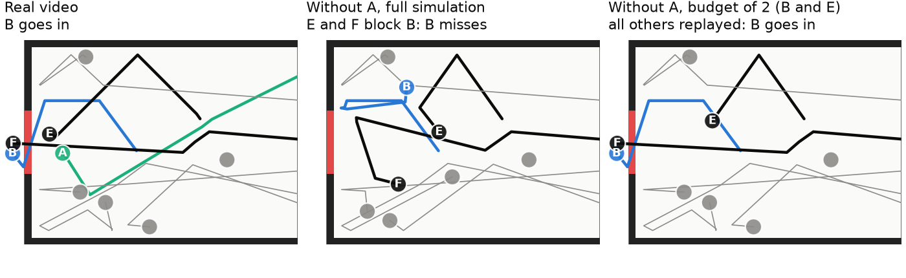

# Counterfactual simulation on a budget

In Lu, Bechlivanidis & Gerstenberg (CogSci 2026), people's answers to "would B have gone through the gate if A had not been there?" drift away from the Counterfactual Simulation Model (CSM) as scenes get crowded, and end up close to their answers about whether A touched B at all. This repository tests one explanation: when people imagine the scene without A, they re-simulate only a few balls (B first) and let every other ball move along the path it really took.

On the 20 videos of that study, a budget of two balls fits people's whether ratings better than the full CSM, a CSM whose noise grows with crowding, or the contact check alone. The advantage is not decisive with 20 videos, so we also designed new scenes in which the models make clearly different predictions, for a lab to run.

## Result on the existing data

Each model maps its prediction p (the share of imagined replays in which B misses) to the rating scale with a fitted line, and is scored on each video after being fit to the other 19. Error is root mean squared error in rating points (0 to 100).

| Model | What it imagines without A | Held-out error | r |
| --- | --- | --- | --- |
| Budget (ours) | B and one other ball are re-simulated; every other ball replays its real path | 18.2 | .80 |
| Crowding noise | Full re-simulation, with noise that grows with the number of balls | 22.5 | .67 |
| How only | No simulation: B "would have missed" only if A touched B through a chain of contacts | 24.3 | .59 |
| Full CSM | Full re-simulation, with noise on the ball A hit first (the published model) | 25.1 | .55 |

- **Best budget:** 2 balls, filled with B and then the first ball A hit in the real video. This was the setting chosen in all 20 cross-validation folds, over budgets of 1 and 3 and over "every ball" (which is the full CSM). On held-out error alone, a budget of 1 does as well (18.2), so the existing data do not pin down the budget size.
- **Not decisive:** resampling the 50 participants 1,000 times, the budget model beats the full CSM in 96% of resamples (gap −5.4 points, 95% interval −10.8 to +0.6), crowding noise in 81% (−2.7, interval −7.4 to +2.8) and how only in 87% (−4.2, interval −11.4 to +2.6). We set a 95% interval excluding zero as the bar before fitting, and the result does not clear it.
- **Crowding:** the budget model's error does not grow with the number of balls (slope −0.8 points per ball, interval −2.2 to +0.6).
- **Individuals:** fitting each participant separately, the budget model fits 34% best, how only 28%, crowding noise 28% and the full CSM 10%. Across all 50 people, the best budget is 1 ball for 13, 2 for 25 and 3 for 12.
- **Cause ratings:** the authors' proposed next step weights the whether and how answers by people's certainty. That model predicts the cause ratings better with the budget model's whether answers (held-out error 16.7) than with the CSM's (18.3). The whether settings used here were fit on all 20 videos, so this comparison is slightly optimistic for both.

Full numbers are in `results/evaluation.json`.

## How the budget model works

Remove A. Re-simulate B and up to k − 1 other balls, chosen by a rule that uses only what the real video shows (we tested three: balls A touched, balls that touched B, and balls that came closest to B's path). Every other ball is reset to its recorded position and velocity at each time step. It therefore follows its real path exactly and is never pushed off it, but it still pushes any re-simulated ball it meets, with the force of a real ball. As in the CSM, direction noise goes on the ball A hit first, if that ball is in the budget.

Because the replayed balls already carry A's effects, with k = 1 B's imagined path can differ from its real path only if A hit B directly, and the model says A mattered only when that hit decided whether B went in. A's influence through chains of other balls drops out. With every ball in the budget, the model is the full CSM. In the 9-ball video below, A sends E and F away and never touches B. A full simulation without A sends E and F into B, and B misses. A budget of B and E (the first ball A hit) replays every other ball along its real path, and B goes in, which is what people said.



## Test scenes for a new study

`scenes/final/` holds 36 videos a lab could run with the original whether question: 32 new scenes and 4 original videos as anchors. `PLAN.md` there is a pre-registration-style plan (hypotheses, analysis, pass and fail lines, known weak spots).

The new scenes were chosen by fixed rules from 500,000 random scenes in the style of the originals, of which 37,167 passed the original videos' constraints. Scenes in which A or B passes within 6 pixels of another ball without touching it were left out, since a viewer could not tell whether they touched. A scene qualifies when two models' predicted probabilities differ by at least 40 points at every setting we treat as plausible: budgets of 1 to 3 balls (1 and 3 fit a little worse than 2 but are kept), and every noise level on the paper's grid (0 to 5 degrees) whose fit is inside the 95% bootstrap interval of the best fit's error. The budget model's noise range is that of its best budget (2), used for all three sizes. At the fitted rating scales, the which-model scenes separate the models by 41 to 47 rating points on average.

| Kind of scene | Scenes | Budget | Full CSM | Crowding | How only |
| --- | --- | --- | --- | --- | --- |
| Clear the way: without A, B misses in full simulation but not on a budget | 8 | 25 | 73 | 66 | 55 |
| Budget vs. crowding noise | 8 | 25 | 66 | 69 | 50 |
| Hit but no difference: A reaches B, but B would have gone in anyway | 8 | 25 | 16 | 16 | 66 |
| Budget of 1 vs. 2, and 2 vs. 3 (two scenes each way per pair) | 8 | 25 or 83 | 48 | 56 | 66 |
| Original videos | 4 | 54 | 62 | 41 | 45 |

Values are each model's mean predicted rating at its best fit to the existing data (`scenes/final/summary.csv`; every setting is in `predictions.csv`).

- **Simple cues:** across the 32 new scenes, no crude cue (A's closest approach to B, number of collisions, number of balls, whether A passes within a ball width of B's path) correlates with any model's disagreement with the budget model above |r| = .3 (largest .26). Getting there took 78 rule-based swaps. Half-size and quarter-size sets could not get under .3, which is why the set has 36 scenes.
- **Power:** we simulated 200 studies of 50 people from each model. Each fake person copies one real participant's slider scale and noise (fit to their 20 ratings under the generating model). The generating model won every study, and the budget size was recovered every time for budgets of 1, 2 and 3. A population mixing budgets in the proportions of the per-person fits (13, 25 and 12 people) was identified as a budget population every time, with k = 2 in 199 of 200 studies. These studies assume each person follows one model, so they show the scenes can separate the models, not that real data will be this clean.
- **Other bars:** the same result holds with a 30 or 50 point bar instead of 40, and with a cue line of .4. A stricter cue line of .2 cannot be met (best .28).

## Our simulator

The original repository has no licence file, so we did not copy or import its code. `FACTSHEET.md` lists the physical settings and model rules we took from the paper and code (table and gate size, ball size, speed scale, time step, elasticity, where and how noise is applied), with the source of each. `sim/` was written from that list.

Checks against the original:

- The noise-free counterfactual outcome and the how answer match the original in all 20 videos.
- At θ = 1.9 (1,000 replays per video, 20 random seeds) our CSM correlates with people's mean whether ratings at r = .670 (range .664 to .679; `results/reproduction.csv`). The original code, run locally the same way, gives .674 (range .667 to .682; its predictions are in `results/original_code_seeds.csv`, the code itself is not included). Per video the two agree within 1 point. The paper reports .684 (and .694 in the text), which is above the original code's own seed range.

## Repository layout

| Folder | Contents |
| --- | --- |
| `FACTSHEET.md` | The settings our simulator is built from, with sources |
| `sim/` | Physics (`physics.py`) and the models (`models.py`) |
| `fit/` | Prediction grid (`predict.py`), fitting and evaluation (`evaluate.py`), reproduction check (`reproduce.py`) |
| `scenes/` | Scene generator, validity filter, screening and selection, model recovery, rendering |
| `analysis/` | Figures |
| `results/` | Predictions, fits and bootstrap results |
| `writeup/` | The two-page write-up and its figures |

## Reproducing

Python 3.12 with the packages in `requirements.txt` (pymunk must be 6.x). Get the original materials and point `ORIGINAL` at them:

```
git clone https://github.com/cicl-stanford/complex_causation_cogsci2026
export ORIGINAL=$PWD/complex_causation_cogsci2026
pip install -r requirements.txt
python fit/reproduce.py      # about 3 minutes on 8 cores
python fit/predict.py        # every model and setting; a few hours on 8 cores
python fit/evaluate.py
python analysis/figures.py
python scenes/screen.py 500000          # generate, filter, screen, confirm; about 10 hours on 8 cores
python scenes/select.py 40 12 0.3       # choose scenes, cue check, model recovery (uses the included scenes/work/candidates.json)
python scenes/finalize.py results/selection_40_12_0.3.json
```

## Credit

Scenes and ratings, including the four anchor scenes copied into `scenes/final/test_scenes.json`: Lu, Bechlivanidis & Gerstenberg (2026), "Causal judgments in complex situations", CogSci 2026; materials at github.com/cicl-stanford/complex_causation_cogsci2026. The capacity limit motivating the budget: Balaban & Ullman (2025), "The capacity limits of moving objects in the imagination", Nature Communications.

Our code is under the MIT licence (`LICENSE`). The original study's scenes and ratings belong to its authors and are not covered by it.
